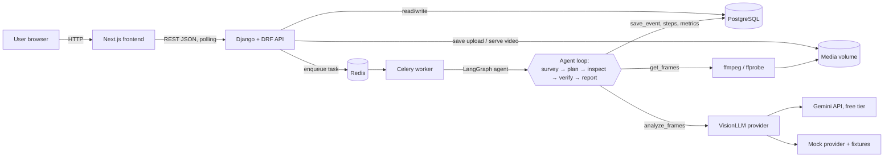
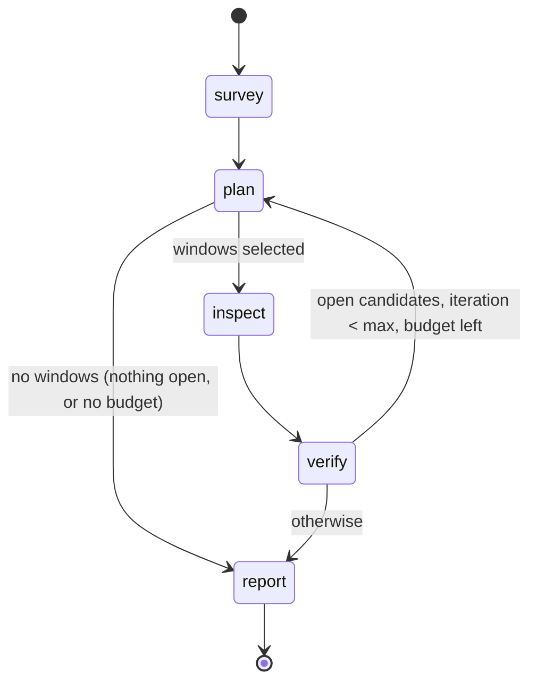

# Shop Floor Video Agent

[](https://github.com/samucadutra/shop-floor-video-agent/actions/workflows/ci.yml)

Upload a short factory or warehouse video, and an AI agent reports the safety events in it: missing PPE, people too close to moving machinery, and spills. It does not send every frame to a vision model. It surveys the clip cheaply, picks the moments worth a closer look, inspects them, verifies each candidate and writes a report. Every decision is saved as a visible trace.

It is a portfolio proof of concept: Django, Celery, LangGraph, Gemini (free tier) or an offline mock, Next.js, Docker Compose, Kubernetes (kind) and GitHub Actions. Design docs: [PRD](docs/prd.md), [spec](docs/spec.md), [tasks](docs/tasks.md), [demo script](docs/demo.md).

> **PoC, needs human review.** The events are AI-generated. A person should check each one in the video before acting on it.

## Screenshots

| Upload | Video detail with agent trace | Dashboard |
| ------ | ----------------------------- | --------- |
| [](docs/screenshots/upload.png) | [](docs/screenshots/detail.png) | [](docs/screenshots/dashboard.png) |

The detail page shows sample 1 analyzed with the mock provider: two events on the timeline, and a `verify` step that drops a decoy ("The worker wears a white hard hat and an orange hi-vis jacket").

## Quick start

You only need Docker (with Compose v2), `curl` and `make`. No API key is needed: with no `.env`, Compose uses the offline mock provider.

```bash
cp .env.example .env        # optional; the defaults use LLM_PROVIDER=mock
make samples                # downloads the 4 demo clips to samples/ and checks their SHA-256
docker compose up -d --build
```

- UI: http://localhost:3000. Go to **Upload**, drop `samples/16106604.mp4`, click **Analyze**, and watch the trace fill in.
- API: http://localhost:8000/api/ (health check: `curl http://localhost:8000/api/health/`).
- Stop with `docker compose down` (add `-v` to delete the database and uploaded media).

## LLM providers

The provider is chosen only by `LLM_PROVIDER` in `.env`. Restart the backend and worker after a change: `docker compose up -d --force-recreate backend worker`.

| `LLM_PROVIDER` | What it does | Needs |
| -------------- | ------------ | ----- |
| `mock` | Deterministic and offline. It replays fixtures written frame by frame for the 4 sample clips (matched by SHA-256, then by file name), including decoys that the verify step drops. Any other video gets generic events labeled "demo event (no fixture)". | nothing |
| `gemini` (code default) | Google Gemini vision model on the free tier. | `GEMINI_API_KEY` from [Google AI Studio](https://aistudio.google.com/) and `GEMINI_MODEL` (a Flash or Flash-Lite model) |

**Free tier notes**

- Limits are low (around 10 requests per minute plus a daily cap, depending on the model and project). See the AI Studio [rate limits page](https://ai.google.dev/gemini-api/docs/rate-limits). The agent throttles itself (`LLM_MAX_REQUESTS_PER_MINUTE=8`), sends up to 12 frames per call, makes at most 20 calls per run, and backs off on 429 and 5xx errors. A run on a 25 s clip takes a few minutes, mostly waiting for the throttle.
- When the daily quota runs out, the run fails with a clear message. The quota is counted per model and can be as low as a few dozen requests a day, which is about one or two clips. Switch `GEMINI_MODEL` to another Flash model, switch to `mock`, or try again the next day. Popular models also return HTTP 503 at busy times; the agent retries with backoff.
- Prices default to `0`, so the cost guardrail has no effect. Tokens are always tracked. Set `LLM_INPUT_PRICE_PER_MTOK` and `LLM_OUTPUT_PRICE_PER_MTOK` to see what a paid tier would cost.
- Model names are never hardcoded. If `GEMINI_MODEL` stops working, pick a current Flash model from the AI Studio list.

> **Privacy warning.** On the Gemini free tier, Google may use the data you send to improve its products. Upload only public stock videos, never real plant footage or videos of people who did not agree to it.

## Sample videos

Four free clips from [Pexels](https://www.pexels.com/), used under the [Pexels License](https://www.pexels.com/license/). They are not committed: `make samples` downloads the exact 1280x720 files to `samples/` and checks their hashes, so they match the mock fixtures. Check the license before you use other videos.

| # | File | Clip (creator) | Length | Expected events | Decoys the agent should drop |
| - | ---- | -------------- | ------ | --------------- | ---------------------------- |
| 1 | `16106604.mp4` | [Men working at a construction site](https://www.pexels.com/video/men-working-at-a-construction-site-16106604/) (Sururi Ballıdağ) | 25 s | `missing_ppe` ~0–4 s (no hard hat); `unsafe_proximity` ~6–21 s (worker next to a moving yard forklift) | `missing_ppe` for the worker with a hard hat and an orange hi-vis jacket |
| 2 | `4294438.mp4` | [Man working warehouse occupation](https://www.pexels.com/video/man-working-warehouse-occupation-4294438/) (Tiger Lily) | 15 s | `missing_ppe`, whole clip (forklift driver with a beanie, no hi-vis vest) | `unsafe_proximity`: nobody is on foot |
| 3 | `13422071.mp4` | [Workers cleaning warehouse](https://www.pexels.com/video/workers-cleaning-warehouse-13422071/) (Rodrigo Garcin) | 15 s | `fallen_object_or_spill` ~0–3 s, low (wet floor being mopped) | `missing_ppe`: the workers wear hi-vis vests |
| 4 | `31751344.mp4` | [Warehouse forklift moving through storage aisles](https://www.pexels.com/video/warehouse-forklift-moving-through-storage-aisles-31751344/) (Dominik Zítka) | 38 s | Control clip: `missing_ppe` ~6 s and ~30 s, low (driver without hard hat or vest) | `unsafe_proximity` when the forklift passes: no person on foot |

SHA-256 hashes and direct download URLs: [PRD Appendix A](docs/prd.md#appendix-a-sample-videos). Recorded results with the mock and with Gemini: [docs/demo.md](docs/demo.md#results-on-the-sample-clips).

## Architecture



1. The browser uploads a video. The API checks the extension, MIME type, size, and `ffprobe` duration, saves the file under a UUID name and creates a `Video` row.
2. **Analyze** creates an `AnalysisRun` and queues a Celery task. Analysis never runs inside an HTTP request, and a second start while a run is active returns `409`.
3. The worker runs the LangGraph agent, which extracts frames with ffmpeg, calls the vision model and saves trace steps and events as it goes.
4. The frontend polls every 3 s until the video is `done` or `failed`. A successful re-analysis replaces the previous events in one transaction. A failed one keeps them.

### Agent loop



| Step | What it does |
| ---- | ------------ |
| `survey` | 1 frame every 2 s plus ffmpeg scene-change frames, sent in batches of up to 12. Returns candidate moments. |
| `plan` | No LLM call. Turns open candidates into time windows (±2 s, wider on a second look), merges overlaps, ranks them by severity and keeps what fits in the frame budget. |
| `inspect` | Extracts 2 fps frames inside each window and asks a focused question about it. |
| `verify` | Text only. Confirms, drops or keeps each candidate open. Confirmed events below the confidence threshold (0.6) are dropped. |
| `report` | Writes the summary. It has reserved tokens and one reserved call, so it runs even when a guardrail stopped the loop. |

Every LLM reply is validated with Pydantic and retried once with the validation error. Guardrails (iterations, frames, tokens, cost, LLM calls, run timeout) come from env vars. A run they stop is marked **partial**, with the stop reason shown in the UI. The full design is in [docs/spec.md](docs/spec.md) (S6).

## Commands

Run them from the repository root.

| Task | Command | What it does |
| ---- | ------- | ------------ |
| Run | `make up` | Builds and starts postgres, redis, backend, worker, frontend |
| Stop | `make down` | Stops the stack (data volumes kept) |
| Logs | `make logs` | Follows backend and worker logs (one JSON object per line) |
| Health | `curl -fsS http://localhost:8000/api/health/` | Checks the DB and Redis through the API |
| Test | `make test` | Backend tests (pytest, mock provider, no network); needs the stack up |
| Lint | `make lint` | ruff (backend), ESLint and `tsc` (frontend, in a throwaway Node container) |
| Sample videos | `make samples` | Downloads the 4 demo clips and checks their SHA-256 |
| Kind up / down | `make kind-up` / `make kind-down` | Local Kubernetes cluster (below) |

## Run on kind

The same stack runs on a local single-node [kind](https://kind.sigs.k8s.io/) cluster. The manifests are in [k8s/](k8s/).

Prerequisites: Docker, `kind` and `kubectl`.

```bash
cp -n .env.example .env     # the cluster Secret is created from this file
docker compose down         # frees ports 3000 and 8000
make kind-up                # creates the cluster, builds and loads the images, applies k8s/, waits for rollouts
kubectl -n shop-floor get pods
```

Then open the UI at http://localhost:3000 and the API at http://localhost:8000/api/ (the same URLs as Compose; kind maps NodePorts 30030 and 30080 to them).

- The `app-secrets` Secret is created from `.env` (`kubectl create secret generic app-secrets --from-env-file=.env`) and is never committed. Its values override the `app-config` ConfigMap, except `DJANGO_DEBUG`, which is always `false` on the cluster.
- The ConfigMap sets `LLM_PROVIDER=mock`, so no API key is needed. To use Gemini, set `LLM_PROVIDER`, `GEMINI_API_KEY` and `GEMINI_MODEL` in `.env`, then run `make kind-up` again and `kubectl -n shop-floor rollout restart deploy/backend deploy/worker`.
- Logs: `kubectl -n shop-floor logs deploy/worker -f`.
- Media (uploads and frames) live on a `ReadWriteOnce` volume shared by the backend and the worker. That works because kind has one node; production would use object storage.
- `make kind-down` deletes the cluster and all its data.

## CI

[`.github/workflows/ci.yml`](.github/workflows/ci.yml) runs on every push to `main` and on pull requests. It needs no secrets and never calls a real LLM.

| Job | What it checks |
| --- | -------------- |
| `backend` | ruff lint and format, then pytest with the mock provider, against Postgres and Redis service containers |
| `frontend` | `npm ci`, ESLint, `tsc`, `next build` |
| `docker` | Builds the backend and frontend images (no push) |
| `k8s` | Validates the manifests with kubeconform |

To run the same checks locally, use `make lint` and `make test`. The actionlint and kubeconform commands are in [docs/tasks.md](docs/tasks.md) (Phase 10).

## Limitations

- **Accuracy.** A free tier vision model can miss events or flag false ones. On the 4 samples, Gemini found 3 of the 6 expected events and flagged 2 false ones (see [docs/demo.md](docs/demo.md#gemini-free-tier-2026-10-14)). Verify, the confidence threshold and the trace reduce errors, but every event still needs a human check.
- **Frame savings on very short clips.** The agent always surveys the whole clip and then inspects windows at 2 fps. On the 15–25 s samples it uses roughly 65–80% of the frames a full 2 fps pass would need, and more when the model flags something every few seconds. The 38 s clip uses 36–49%. The savings grow with the clip length (see [docs/demo.md](docs/demo.md#results-on-the-sample-clips)).
- **Mock realism.** The mock replays hand-written fixtures. It shows the full loop offline, but it does not look at the pixels.
- **Throughput.** One worker runs one analysis at a time, which keeps the in-process throttle correct. Free tier runs take minutes.
- **Scope.** No authentication, users or multi-tenancy. Only uploaded files (no live streams) are analyzed, and no alerts are sent. Media is stored on a local shared volume.

## What production would add

- A cloud deployment (for example Azure AKS or AWS EKS) with continuous deployment.
- Authentication and roles.
- A human review step before any alert is sent.
- A paid LLM tier with a data processing agreement, and possibly face blurring.
- Object storage for videos and frames instead of a shared volume.
