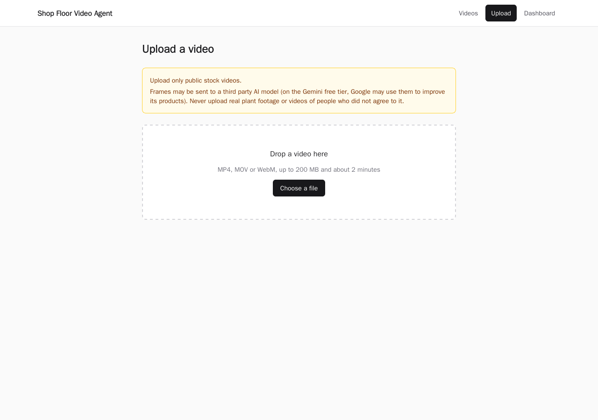
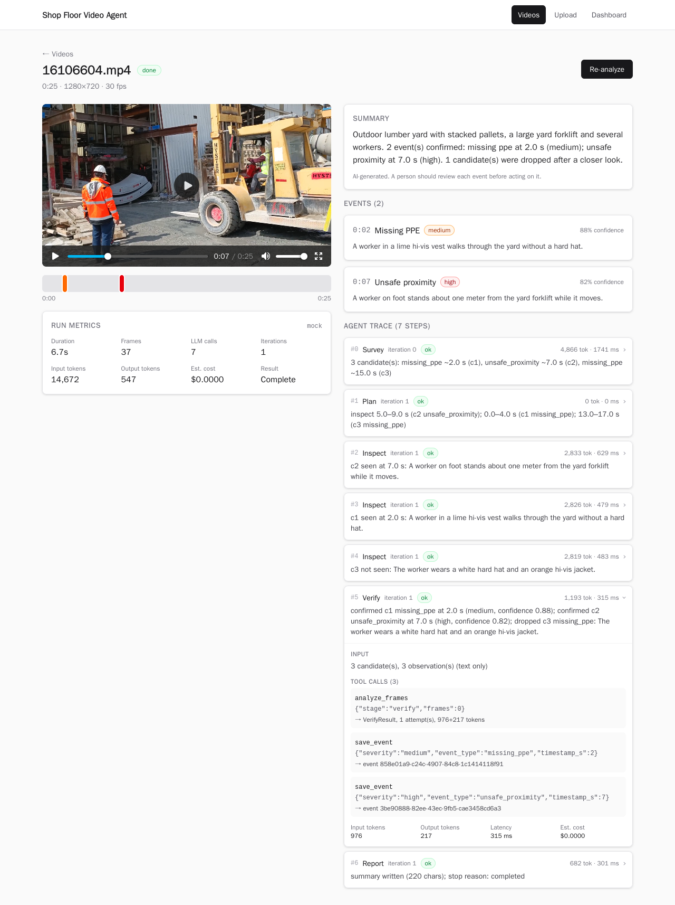
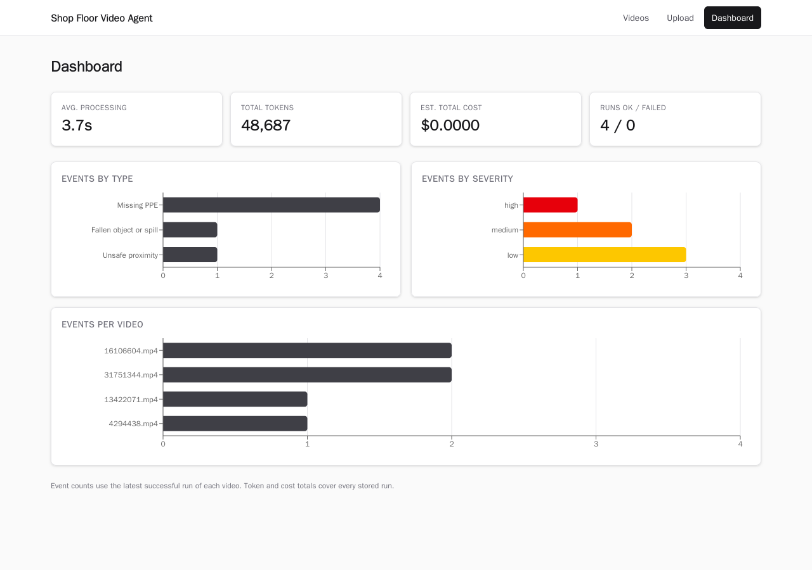
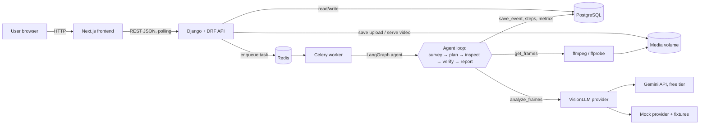
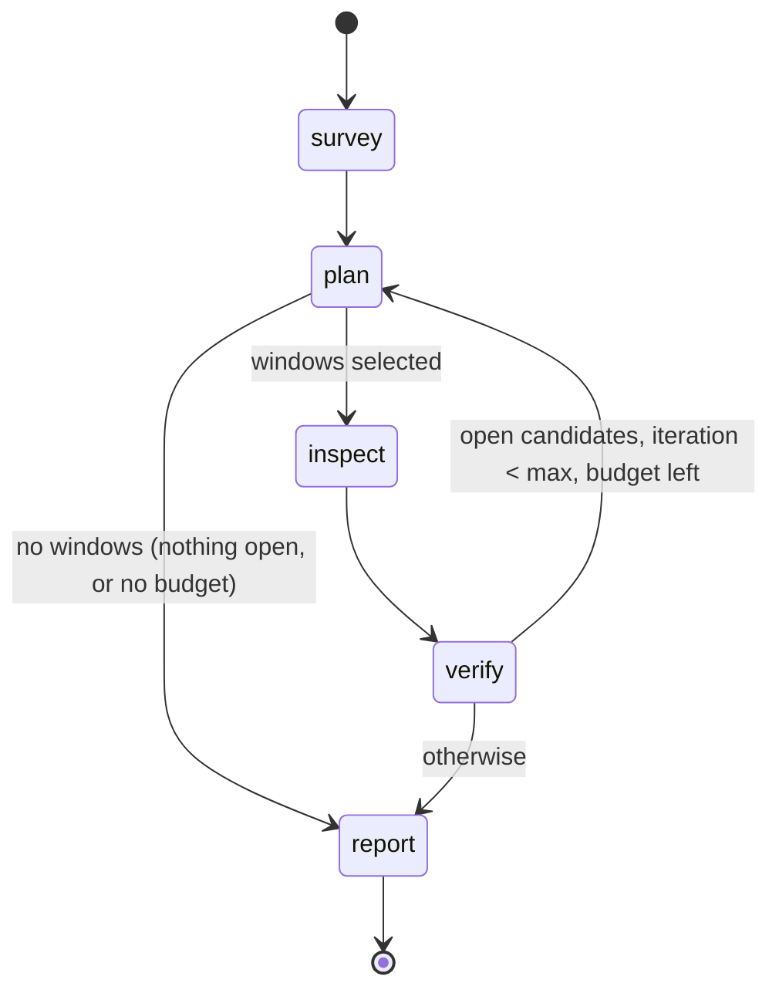

# Shop Floor Video Agent

[](https://github.com/samucadutra/shop-floor-video-agent/actions/workflows/ci.yml)

<!-- Demo GIF: record it, save it as docs/demo.gif, then replace the placeholder line below with:
 -->
_Demo GIF: coming soon._

Plants record hours of camera footage that nobody has time to watch, so near misses like a missing hard hat, a worker next to a moving forklift or a wet floor go unnoticed. Sending every frame to a vision model is slow and expensive. Shop Floor Video Agent is a portfolio proof of concept that shows a cheaper way. You upload a short factory or warehouse clip, and an AI agent decides where to look. It surveys the clip at a low frame rate, plans which moments deserve a closer look, inspects them, verifies each candidate, and reports timestamped safety events with a severity, a confidence score and an explanation. Every decision is saved as a trace you can read in the UI. It was built to show an agentic video-analysis system applied to industrial safety, end to end: API, background jobs, UI, Docker, Kubernetes and CI.

> **PoC, needs human review.** The events are AI-generated. A person should check each one in the video before acting on it.

## Screenshots

| Upload | Video detail with agent trace | Dashboard |
| ------ | ----------------------------- | --------- |
| [](docs/screenshots/upload.png) | [](docs/screenshots/detail.png) | [](docs/screenshots/dashboard.png) |

The detail page shows sample 1 analyzed with the mock provider: two events on the timeline, and a `verify` step that drops a decoy ("The worker wears a white hard hat and an orange hi-vis jacket").

## Architecture



1. The browser uploads a video. The API checks the extension, MIME type, size, and `ffprobe` duration, saves the file under a UUID name and creates a `Video` row.
2. **Analyze** creates an `AnalysisRun` and queues a Celery task. Analysis never runs inside an HTTP request, and a second start while a run is active returns `409`.
3. The worker runs the LangGraph agent, which extracts frames with ffmpeg, calls the vision model and saves trace steps and events as it goes.
4. The frontend polls every 3 s until the video is `done` or `failed`. A successful re-analysis replaces the previous events in one transaction. A failed one keeps them.

## How the agent works



| Step | What it does |
| ---- | ------------ |
| `survey` | 1 frame every 2 s plus ffmpeg scene-change frames, sent in batches of up to 12. Returns candidate moments. Repeated sightings of the same event a few seconds apart are merged into one candidate. |
| `plan` | No LLM call. Turns open candidates into time windows (±2 s, wider on a second look), merges overlaps, ranks them by severity and keeps what fits in the frame budget. |
| `inspect` | Extracts 2 fps frames inside each window and asks a focused question about it. |
| `verify` | Text only. Confirms, drops or keeps each candidate open. Confirmed events below the confidence threshold (0.6) are dropped. |
| `report` | Writes the summary. It has reserved tokens and one reserved call, so it runs even when a guardrail stopped the loop. |

**Why an agent instead of a fixed pipeline.** A fixed pipeline does the same work on every clip: extract N frames, send them all, parse the answer. The agent spends its budget where the video needs it:

- **It looks closer only where something may be happening.** A quiet clip ends after the survey: one or two calls and no inspect frames. A busy clip gets 2 fps windows around each candidate.
- **The next step depends on the last result.** The plan is built from the survey's candidates. Verify can send an unclear candidate back for a second, wider look while budget remains, or drop a decoy with a reason ("the worker wears a hard hat").
- **Limits are enforced on every step.** Iterations, frames, tokens, cost and LLM calls are checked before each call. A run that hits a limit still writes a report, marked partial with the reason.
- **Every decision is recorded.** The trace shows which windows were chosen or skipped and why, so a reviewer can trust or reject each event.

Every LLM reply is validated with Pydantic and retried once with the validation error. Tools (`get_frames`, `analyze_frames`, `save_event`) are plain functions that the graph calls, which keeps the agent easy to test with a mock. The full design is in [docs/spec.md](docs/spec.md) (S6).

## Tech stack

| Layer | Technology |
| ----- | ---------- |
| Backend | Python 3.12, Django 5.2, Django REST Framework, PostgreSQL 16 |
| Background jobs | Celery with Redis 7 as the broker |
| Agent | LangGraph state graph, Pydantic v2 schemas for every LLM reply |
| Vision model | Google Gemini (free tier) through `google-genai`, or an offline fixture-driven mock |
| Video | ffmpeg and ffprobe (frame sampling, scene detection, resizing) |
| Frontend | Next.js 16 (App Router), React 19, TypeScript (strict), Tailwind CSS, Recharts |
| Observability | JSON logs with run and node context, secret redaction, run metrics, agent trace |
| Deployment | Docker Compose, Kubernetes manifests for kind |
| Quality | pytest + pytest-django, ruff, ESLint, `tsc`, GitHub Actions |

## How to run

### Docker Compose

You only need Docker (with Compose v2), `curl` and `make`. No API key is needed: with no `.env`, Compose uses the offline mock provider.

```bash
cp .env.example .env        # optional; the defaults use LLM_PROVIDER=mock
make samples                # downloads the 4 demo clips to samples/ and checks their SHA-256
docker compose up -d --build
```

- UI: http://localhost:3000. Go to **Upload**, drop `samples/16106604.mp4`, click **Analyze**, and watch the trace fill in.
- API: http://localhost:8000/api/ (health check: `curl http://localhost:8000/api/health/`).
- Stop with `docker compose down` (add `-v` to delete the database and uploaded media).

### LLM providers

The provider is chosen only by `LLM_PROVIDER` in `.env`. Restart the backend and worker after a change: `docker compose up -d --force-recreate backend worker`.

| `LLM_PROVIDER` | What it does | Needs |
| -------------- | ------------ | ----- |
| `mock` | Deterministic and offline. It replays fixtures written frame by frame for the 4 sample clips (matched by SHA-256, then by file name), including decoys that the verify step drops. Any other video gets generic events labeled "demo event (no fixture)". | nothing |
| `gemini` (code default) | Google Gemini vision model on the free tier. | `GEMINI_API_KEY` from [Google AI Studio](https://aistudio.google.com/) and `GEMINI_MODEL` (a current Flash or Flash-Lite model) |

**Free tier notes**

- **Rate limits.** Limits are low: around 10 requests per minute plus a daily cap, depending on the model and project (see the AI Studio [rate limits page](https://ai.google.dev/gemini-api/docs/rate-limits)). The agent throttles itself (`LLM_MAX_REQUESTS_PER_MINUTE=8`), sends up to 12 frames per call, makes at most 20 calls per run, and backs off on 429 and 5xx errors.
- **Daily quota.** The daily quota is counted per model and can be as low as a few dozen requests, which is one or two clips. When it runs out, the run fails with a clear message: switch `GEMINI_MODEL` to another Flash model, switch to `mock`, or try again the next day.
- **Busy models.** Popular models return HTTP 503 at busy times, and retried requests seem to count against the quota. A lower `LLM_MAX_RETRIES` (for example `1`) makes a busy model fail fast instead of using up the day's quota.
- **Cost.** Prices default to `0`, so the cost guardrail has no effect. Tokens are always tracked: set `LLM_INPUT_PRICE_PER_MTOK` and `LLM_OUTPUT_PRICE_PER_MTOK` to see what a paid tier would cost.
- **Model names.** They are never hardcoded. Older models are retired (for example `gemini-1.5-flash` returns 404), so pick a current one from the AI Studio list.

> **Privacy warning.** On the Gemini free tier, Google may use the data you send to improve its products. Upload only public stock videos, never real plant footage or videos of people who did not agree to it.

### Kubernetes (kind)

The same stack runs on a local single-node [kind](https://kind.sigs.k8s.io/) cluster. The manifests are in [k8s/](k8s/).

Prerequisites: Docker, `kind` and `kubectl`.

```bash
cp -n .env.example .env     # the cluster Secret is created from this file
docker compose down         # frees ports 3000 and 8000
make kind-up                # creates the cluster, builds and loads the images, applies k8s/, waits for rollouts
kubectl -n shop-floor get pods
```

Then open the UI at http://localhost:3000 and the API at http://localhost:8000/api/ (the same URLs as Compose; kind maps NodePorts 30030 and 30080 to them).

- The `app-secrets` Secret is created from `.env` (`kubectl create secret generic app-secrets --from-env-file=.env`) and is never committed. Its values override the `app-config` ConfigMap, except `DJANGO_DEBUG`, which is always `false` on the cluster.
- The ConfigMap sets `LLM_PROVIDER=mock`, so no API key is needed. To use Gemini, set `LLM_PROVIDER`, `GEMINI_API_KEY` and `GEMINI_MODEL` in `.env`, then run `make kind-up` again and `kubectl -n shop-floor rollout restart deploy/backend deploy/worker`.
- Logs: `kubectl -n shop-floor logs deploy/worker -f`.
- Media (uploads and frames) live on a `ReadWriteOnce` volume shared by the backend and the worker. That works because kind has one node; production would use object storage.
- `make kind-down` deletes the cluster and all its data.

### Commands

Run them from the repository root.

| Task | Command | What it does |
| ---- | ------- | ------------ |
| Run | `make up` | Builds and starts postgres, redis, backend, worker, frontend |
| Stop | `make down` | Stops the stack (data volumes kept) |
| Logs | `make logs` | Follows backend and worker logs (one JSON object per line) |
| Health | `curl -fsS http://localhost:8000/api/health/` | Checks the DB and Redis through the API |
| Sample videos | `make samples` | Downloads the 4 demo clips and checks their SHA-256 |
| Kind up / down | `make kind-up` / `make kind-down` | Local Kubernetes cluster |

## Tests

The tests never call a real LLM. They use the mock provider, and the test videos are generated at test time with ffmpeg (`testsrc`), so no video files are needed.

```bash
make up            # the tests run inside the backend container
make test          # pytest: API, upload validation, media Range requests, ffmpeg, agent loop, guardrails, providers
make lint          # ruff (backend), ESLint and tsc (frontend, in a throwaway Node container)
```

The agent tests run the full survey → plan → inspect → verify → report loop on a generated clip. They check that each guardrail stops a run with the right stop reason, that invalid JSON is retried, that decoys are dropped, that provider outages and quota errors fail cleanly, and that re-analysis never duplicates events.

**CI.** [`.github/workflows/ci.yml`](.github/workflows/ci.yml) runs on every push to `main` and on pull requests. It needs no secrets.

| Job | What it checks |
| --- | -------------- |
| `backend` | ruff lint and format, then pytest with the mock provider, against Postgres and Redis service containers |
| `frontend` | `npm ci`, ESLint, `tsc`, `next build` |
| `docker` | Builds the backend and frontend images (no push) |
| `k8s` | Validates the manifests with kubeconform |

The actionlint and kubeconform commands to run the same checks locally are in [CLAUDE.md](CLAUDE.md#commands).

## Results

All 4 sample clips (92 s of video in total) were analyzed with Gemini `gemini-3.5-flash-lite` on the free tier, with the default limits. The table compares two runs, normalized per minute of video:

- **Before (15 Oct 2026):** the first version.
- **After (19 Oct 2026):** three small changes, chosen after reading the traces of the first run:
  - the prompts ask for a single JSON object (the model sometimes answered verify with a bare list, which failed validation);
  - repeated survey sightings of one continuous event are merged into one candidate;
  - the definitions now exclude a machine's own operator, stationary machines and neatly stacked materials.

| Per minute of video | Full 2 fps pass (reference) | Before | After |
| ------------------- | --------------------------- | ------ | ----- |
| Frames analyzed | 120 | 79 | **43** |
| LLM calls | – | 17.5 | **9.7** |
| Tokens (input + output) | – | 98,307 | **52,692** |
| Estimated cost | – | $0.00 (free tier) | $0.00 (free tier) |
| Processing time | – | 136 s | **69 s** |

- **Cost.** It is $0 because the free tier prices are set to 0. Multiply the tokens by your provider's price to estimate a paid tier.
- **Processing time.** It includes the waits added by the 8 requests per minute throttle.
- **Quality.**
  - After the changes, the run had no false positives and no rejected replies. Before, there was 1 false positive (a stationary forklift), 3 verify replies were rejected as invalid, and one continuous event was reported 4 times.
  - Both runs still missed events that a person would flag: the wet floor in clip 3 and the hard hat in clip 1, and after the changes also the forklift driver in clip 4. Flash-Lite has limited recall. The full Flash models found more, but were often overloaded on the free tier.
- **Caveat.** These are single runs, so part of the difference is the model's run-to-run variation.

Per-clip results with the mock and with Gemini are in [docs/demo.md](docs/demo.md#results-on-the-sample-clips).

## Sample videos (not in the repo)

The videos are not committed. Four free clips from [Pexels](https://www.pexels.com/) are used under the [Pexels License](https://www.pexels.com/license/). `make samples` downloads the exact 1280x720 files to `samples/` (git-ignored) and checks their SHA-256 hashes, so they match the mock fixtures. Check the license before you use other videos.

| # | File | Clip (creator) | Length | Expected events | Decoys the agent should drop |
| - | ---- | -------------- | ------ | --------------- | ---------------------------- |
| 1 | `16106604.mp4` | [Men working at a construction site](https://www.pexels.com/video/men-working-at-a-construction-site-16106604/) (Sururi Ballıdağ) | 25 s | `missing_ppe` ~0–4 s (no hard hat); `unsafe_proximity` ~6–21 s (worker next to a moving yard forklift) | `missing_ppe` for the worker with a hard hat and an orange hi-vis jacket |
| 2 | `4294438.mp4` | [Man working warehouse occupation](https://www.pexels.com/video/man-working-warehouse-occupation-4294438/) (Tiger Lily) | 15 s | `missing_ppe`, whole clip (forklift driver with a beanie, no hi-vis vest) | `unsafe_proximity`: nobody is on foot |
| 3 | `13422071.mp4` | [Workers cleaning warehouse](https://www.pexels.com/video/workers-cleaning-warehouse-13422071/) (Rodrigo Garcin) | 15 s | `fallen_object_or_spill` ~0–3 s, low (wet floor being mopped) | `missing_ppe`: the workers wear hi-vis vests |
| 4 | `31751344.mp4` | [Warehouse forklift moving through storage aisles](https://www.pexels.com/video/warehouse-forklift-moving-through-storage-aisles-31751344/) (Dominik Zítka) | 38 s | Control clip: `missing_ppe` ~6 s and ~30 s, low (driver without hard hat or vest) | `unsafe_proximity` when the forklift passes: no person on foot |

The mock fixtures are matched by these SHA-256 hashes (the exact 1280x720 files that `make samples` downloads):

| # | File | SHA-256 |
| - | ---- | ------- |
| 1 | `16106604.mp4` | `e20b2a53363817e70a236b7139b48a6c85bd14ba822f8f741ab64500e2e55a75` |
| 2 | `4294438.mp4` | `85f85ea690f98a8d920f9180d2538867fd4f1fa682857a28e834aa94f8e0639b` |
| 3 | `13422071.mp4` | `aadaf12cddba076bf6a7acf31abea68f75b121f90a45cf7d9283fd1082819851` |
| 4 | `31751344.mp4` | `2d4cc7eb91aa93361a0e1d756451452c073fcbd46a741e4e954aa4e1ddf5de18` |

Direct download URLs: [PRD Appendix A](docs/prd.md#appendix-a-sample-videos). If a direct link stops working, `make samples` falls back to the Pexels download page, and the mock still matches the file by name.

## Limitations

- **Accuracy.** A free tier vision model misses events and sometimes flags false ones. On the 4 samples, the best runs found about half of the expected events. Verify, the confidence threshold and the trace reduce errors, but every event still needs a human check.
- **Frame savings depend on the clip.** The agent always surveys the whole clip, then inspects 2 fps windows around each candidate. A short clip with a long continuous event can need close to a full 2 fps pass. A quiet or long clip needs much less (see [Results](#results)).
- **Free tier capacity.** Daily quotas are small and models get overloaded, so a full 4-clip run can fail partway. The mock always works.
- **Mock realism.** The mock replays hand-written fixtures. It shows the full loop offline, but it does not look at the pixels.
- **Throughput.** One worker runs one analysis at a time, which keeps the in-process throttle correct. Free tier runs take minutes.
- **Scope.** No authentication, users or multi-tenancy. Only uploaded files (no live streams) are analyzed, and no alerts are sent. Media is stored on a local shared volume.

## What a production version would add

- **Cloud deployment.** A managed Kubernetes cluster such as Azure AKS (or AWS EKS), with continuous deployment.
- **Authentication and roles,** with multi-site and multi-tenant data separation.
- **Queue scaling.** Several Celery workers autoscaled on queue length, with a shared (Redis-based) rate limiter instead of the in-process throttle, so throughput grows without breaking provider limits.
- **Human review before alerts.** A reviewer confirms each event in the video before any notification is sent.
- **Datadog dashboards and alerts.** The JSON logs already carry `run_id`, `video_id` and `node`, and runs store their metrics. Production would add dashboards for run duration, tokens, cost and events per site, plus alerts on failure rate, quota errors and provider latency.
- **Paid LLM tier** with a data processing agreement, and possibly face blurring before frames leave the site.
- **Object storage** for videos and frames instead of a shared volume.

## How it was built

The project was built with **spec-driven development using [Claude Code](https://claude.com/claude-code)**. The [`docs/`](docs/) folder is the source of truth, written before the code:

| File | Role |
| ---- | ---- |
| [`docs/prd.md`](docs/prd.md) | What to build and why: user stories, agent design, guardrails, API contract, success criteria |
| [`docs/spec.md`](docs/spec.md) | How to build it: data model, API, agent graph, providers, Docker, Kubernetes, CI, env vars |
| [`docs/tasks.md`](docs/tasks.md) | 11 phases, each with tasks and a **Verify** block of commands that must pass |
| [`docs/demo.md`](docs/demo.md) | Demo script, recorded results, and the check against the PRD success criteria |
| [`CLAUDE.md`](CLAUDE.md) | Working rules for Claude Code: one phase at a time, no hardcoded secrets or model names, mock LLM in tests, local commits only on request |

Each phase was implemented by Claude Code from the spec, then closed by running its Verify commands and reviewing the output. When the docs disagreed or something was not covered, the question went back to the developer instead of being guessed. Later changes, like the prompt and sampling changes in [Results](#results), went through the same loop: read the agent traces, propose small changes, apply only the approved ones, update the spec and the tests, and measure again.
