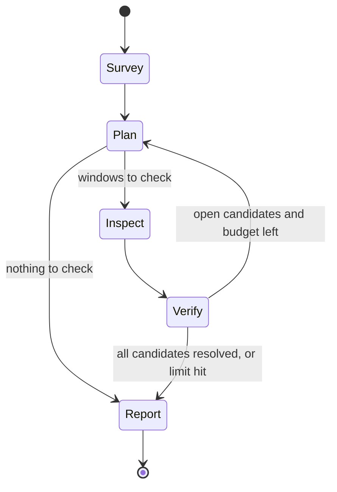
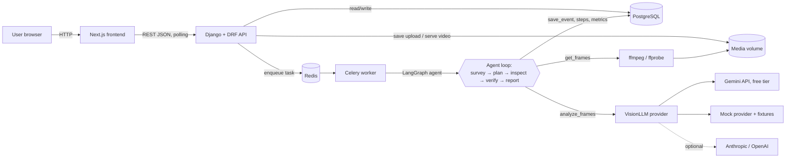

# Shop Floor Video Agent: Product Requirements Document

| Field   | Value                                  |
| ------- | -------------------------------------- |
| Status  | Draft v1                               |
| Date    | 2026-10-14                             |
| Type    | Proof of concept (portfolio project)   |
| Effort  | 2 to 3 days, one engineer              |

---

## 1. Overview and goal

Shop Floor Video Agent is a small, finished product slice. A user uploads a short video recorded on a factory floor or in a warehouse. An AI agent analyzes it and returns a list of safety and operations events. Each event has a timestamp, a severity, a confidence score and a short explanation. The agent also writes a summary of the whole video.

The PoC has two goals:

1. Show an **agentic AI system for video processing and analysis**. The agent plans its own work in a loop (survey, plan, inspect, verify, report) instead of sending every frame to a model.
2. Apply it to **industrial manufacturing**: PPE compliance, unsafe proximity to machinery, and fallen objects or spills.

The project must run fully on a local machine with one command (`docker compose up`). It must also run on a local Kubernetes (kind) cluster. It should look and behave like a real product, not a script. It is a local demo, so it uses a free LLM tier and keeps limits low.

## 2. Problem and target user

**Target user:** a safety or operations manager at a manufacturing plant or warehouse.

**Problem:**

- Plants record a lot of camera footage, but nobody has time to watch it.
- Safety incidents and near misses (no hard hat, a person walking next to a moving forklift, a spill left on the floor) go unnoticed until something goes wrong.
- Sending every frame of every video to a vision model is slow and expensive.

**What the user needs:**

- Upload a clip and get a short, reliable list of "what happened and when".
- Jump straight to the moment in the video to check each event.
- Understand *why* the system flagged something (an explanation and a visible agent trace), so they can trust it or reject it.
- See simple totals over time: what kinds of events happen, how severe they are, and what the analysis costs.

## 3. Scope

### In scope

- Upload of short videos (up to about 2 minutes) with type, size and duration validation.
- Background analysis with Celery and Redis. Analysis never runs inside an HTTP request.
- An agent built with LangGraph that runs a survey, plan, inspect, verify, report loop.
- Three default event types, configurable in one place:
  - `missing_ppe`: a person without a hard hat or safety vest
  - `unsafe_proximity`: a person too close to moving machinery or a forklift
  - `fallen_object_or_spill`: an object dropped or a spill on the floor
- LLM providers behind one interface: **Google Gemini on the free tier (default)** and a deterministic, fixture driven **mock**. Anthropic and OpenAI providers are optional (Phase 5).
- Guardrails: max loop iterations, max frames, max tokens, max estimated cost, timeouts.
- A full agent trace saved per run and shown in the UI.
- A web UI with four pages: Upload, Videos list, Video detail, Dashboard.
- REST API, PostgreSQL storage, structured JSON logs, run metrics.
- Docker Compose for local run, Kubernetes manifests for kind.
- Backend tests with pytest and the mock provider, run locally with one command.
- GitHub Actions CI: backend lint and tests with the mock provider, frontend lint, type check and build, Docker image build.

### Out of scope

- Authentication and user accounts.
- Multi tenancy.
- Real time camera streams (only uploaded files).
- Model training or fine tuning.
- Cloud deployment.
- Sending alerts (email, Slack, etc.).
- Paid LLM tiers and high usage limits.
- Object storage for media (a shared volume is enough).

**A production version would add:** a cloud deployment (for example Azure AKS or AWS EKS), authentication and roles, a human review step before any alert is sent, continuous deployment, a paid LLM tier with a data processing agreement, and object storage for videos and frames.

## 4. User stories with acceptance criteria

### US-1: Upload a video

As a safety manager, I want to upload a video so that the system can analyze it.

- **Given** I am on the Upload page, **when** I drop an `.mp4`, `.mov` or `.webm` file under the size and duration limits, **then** the file uploads, the video appears with status `uploaded`, and I can start the analysis.
- **Given** I drop a file with a wrong type, **when** the upload is validated, **then** I see a clear error and nothing is saved.
- **Given** I drop a file over the size limit or longer than the duration limit, **when** it is validated (in the browser and again on the server), **then** I see a clear error and nothing is saved.

### US-2: Start an analysis

As a safety manager, I want to start the analysis and see its progress.

- **Given** a video with status `uploaded`, `done` or `failed`, **when** I click "Analyze", **then** the API returns a run id, the video status becomes `processing`, and the page polls the status until it is `done` or `failed`.
- **Given** a video that is already `processing`, **when** I try to start another analysis, **then** the API returns `409 Conflict` and no new run starts.
- **Given** a video with status `done`, **when** I click "Re-analyze" and the new run succeeds, **then** the new events replace the previous ones (no duplicates).

### US-3: Review events

As a safety manager, I want to see each event and jump to it in the video.

- **Given** a video with status `done`, **when** I open its detail page, **then** I see a video player, a timeline with one marker per event, event cards (type, severity, confidence, explanation, timestamp), and the summary.
- **Given** the detail page, **when** I click an event marker or card, **then** the player jumps to that second and starts playing.
- **Given** a video with no events found, **when** I open it, **then** I see the summary and an "No events found" message.

### US-4: Understand the agent's reasoning

As a safety manager, I want to see how the agent reached its conclusions so that I can trust or reject them.

- **Given** a finished run, **when** I open the agent trace panel, **then** I see every step in order with: node name, input summary, decision, tool calls, tokens, latency and cost.
- **Given** a run stopped by a guardrail, **when** I open the trace, **then** I see which limit was hit and that the report is partial.

### US-5: See failures clearly

- **Given** the analysis fails (for example the LLM is down after all retries), **when** I open the video, **then** the status is `failed`, I see a short error message, and I can retry.

### US-6: Dashboard

As an operations manager, I want totals across all videos.

- **Given** at least one finished run, **when** I open the Dashboard, **then** I see charts for events by type, events by severity, events per video, plus average processing time, total tokens and total estimated cost.
- **Given** no finished runs, **when** I open the Dashboard, **then** I see an empty state, not an error.

### US-7: Run offline

As a reviewer of this portfolio project, I want to run the full demo without an API key.

- **Given** `LLM_PROVIDER=mock`, **when** I run `docker compose up` and analyze one of the documented sample videos, **then** the run finishes with realistic events that match what happens in that video, a summary and a full trace, and no network call is made to an LLM.
- **Given** `LLM_PROVIDER=mock` and a video with no fixture, **when** I analyze it, **then** the run still finishes with generic, clearly labeled demo events.

## 5. Agent design

### 5.1 Why it is agentic

The agent does not process every frame. It first looks at the video cheaply, then decides where to look closer, and spends its budget only there. Each step's decision depends on the result of the previous step. All decisions are recorded.

### 5.2 Loop

The agent is a LangGraph state graph:



| Step        | What it does                                                                                                                                                                                                                                     | Output                                                     |
| ----------- | ------------------------------------------------------------------------------------------------------------------------------------------------------------------------------------------------------------------------------------------------ | ---------------------------------------------------------- |
| **Survey**  | Extract low rate frames (default 1 frame every 2 s) plus scene change frames with ffmpeg. Send them in small batches to the vision model with the list of event types. Ask for candidate moments.                                                | List of candidates: event type, approx. time, short reason |
| **Plan**    | Merge nearby candidates into time windows (for example ±2 s around each candidate). Rank them by likely severity. Choose which windows to inspect in this iteration, within the remaining frame and cost budget.                                  | List of windows with a focused question per window         |
| **Inspect** | For each window, call `get_frames(start, end, fps)` at a higher rate (default 2 fps) and `analyze_frames(frames, question)` with a focused question, for example "Is the person near the forklift within arm's reach while it moves?"              | Detailed observation per window                            |
| **Verify**  | Confirm or drop each candidate. Assign severity (`low`, `medium`, `high`), a confidence between 0 and 1, an exact timestamp and an explanation. Candidates under the confidence threshold (default 0.6) are dropped. Confirmed events are saved with `save_event(...)`. Unclear candidates can go back to Plan for another look, if budget allows. | Confirmed events, dropped candidates (with reason)         |
| **Report**  | Write a summary of the whole video from the confirmed events and survey notes. Mark the run as partial if a guardrail stopped it.                                                                                                                | Summary text, final run status                             |

### 5.3 Tools

| Tool                                                                    | Description                                                                                                                                                         |
| ----------------------------------------------------------------------- | ------------------------------------------------------------------------------------------------------------------------------------------------------------------- |
| `get_frames(start: float, end: float, fps: float) -> list[Frame]`       | Extract frames with ffmpeg between `start` and `end` seconds. Frames are resized (default max 768 px on the long side) and JPEG encoded. Counts against the frame budget. Cached per run. |
| `analyze_frames(frames: list[Frame], question: str) -> AnalysisResult`  | Send frames (with their timestamps) and a question to the configured vision LLM. Returns a Pydantic validated result. Records tokens, latency and cost.             |
| `save_event(event_type, timestamp_s, severity, confidence, explanation, frame_ref)` | Persist a confirmed event for the current run. Rejects unknown event types and out of range values.                                                     |

Scene change frames come from ffmpeg (`select='gt(scene,THRESHOLD)'`, default threshold 0.4). Video duration and metadata come from `ffprobe`.

### 5.4 Event type configuration

Event types are defined in one config file (`backend/agent/event_types.yaml`). Each entry has: `key`, `label`, `description` (used in prompts), and `default_severity`. Adding a type means adding an entry; no code change.

### 5.5 Structured output

- Each LLM call asks for JSON that matches a Pydantic schema (`SurveyResult`, `InspectResult`, `VerifyResult`, `ReportResult`).
- If parsing or validation fails, the agent retries once, adding the validation error to the prompt.
- If it fails again: during Survey or Report, the run fails with a clear error. During Inspect or Verify, that candidate is dropped and the step is recorded with the error. The run continues.

### 5.6 Guardrails

All limits come from environment variables with safe defaults.

| Guardrail                  | Env var                     | Default  | Behavior when hit                                   |
| -------------------------- | --------------------------- | -------- | --------------------------------------------------- |
| Max loop iterations        | `AGENT_MAX_ITERATIONS`      | 3        | Go to Report, run marked partial                    |
| Max frames per run         | `AGENT_MAX_FRAMES`          | 120      | Stop extracting, go to Report, partial              |
| Max tokens per run         | `AGENT_MAX_TOKENS`          | 200000   | Go to Report, partial                               |
| Max estimated cost per run | `AGENT_MAX_COST_USD`        | 0.50     | Go to Report, partial                               |
| Max LLM calls per run      | `AGENT_MAX_LLM_CALLS`       | 20       | Go to Report, partial                               |
| LLM requests per minute    | `LLM_MAX_REQUESTS_PER_MINUTE` | 8      | Calls wait (throttle) instead of hitting the quota  |
| LLM call timeout           | `LLM_TIMEOUT_SECONDS`       | 60       | Retry with backoff, then fail the step              |
| Total run timeout          | `AGENT_RUN_TIMEOUT_SECONDS` | 600      | Celery soft time limit; run fails with timeout error |

The Report step always has a reserved budget so a summary can be written even when the inspect budget is used up.

The defaults are kept low on purpose, because this is a demo. With the free tier, prices are set to 0, so the cost limit has no effect. The frame, token and LLM call limits still apply. The per-minute throttle keeps the agent under the free tier rate limit. To save requests, the agent sends several frames in one call (default up to 12 frames per call).

### 5.7 Trace

Every agent step is saved as an `AgentStep` row:

- step index, node name (`survey`, `plan`, `inspect`, `verify`, `report`)
- input summary (for example "12 frames, 0–24 s, question: ...")
- decision (for example "inspect windows 14–18 s and 40–44 s; skip 70 s, low signal")
- tool calls with arguments and a short output summary
- input tokens, output tokens, estimated cost, latency in ms
- status (`ok`, `retried`, `error`) and error message

Images are not stored in the trace, only frame references (timestamps and file paths). No secrets are stored.

### 5.8 LLM provider interface

```python
class VisionLLM(Protocol):
    def analyze(self, frames: list[Frame], prompt: str, schema: type[BaseModel]) -> LLMResult: ...
    # LLMResult: parsed object, raw text, input_tokens, output_tokens, latency_ms
```

| Provider    | Selected with                    | Model from env    | Notes                                                                                  |
| ----------- | -------------------------------- | ----------------- | -------------------------------------------------------------------------------------- |
| `gemini`    | `LLM_PROVIDER=gemini` (default)  | `GEMINI_MODEL`    | Needs `GEMINI_API_KEY` from Google AI Studio (free, no billing). Use a Flash or Flash-Lite model, because only those are on the free tier |
| `mock`      | `LLM_PROVIDER=mock`              | none              | Fixture driven, deterministic, no network (Section 5.9)                                |
| `anthropic` | `LLM_PROVIDER=anthropic` (optional) | `ANTHROPIC_MODEL` | Needs `ANTHROPIC_API_KEY`. Phase 5, optional                                  |
| `openai`    | `LLM_PROVIDER=openai` (optional) | `OPENAI_MODEL`    | Needs `OPENAI_API_KEY`. Phase 5, optional                                       |

Model names are never hardcoded. Cost is estimated from token counts and prices set in env vars (`LLM_INPUT_PRICE_PER_MTOK`, `LLM_OUTPUT_PRICE_PER_MTOK`). They default to `0` for the free tier. Tokens are always tracked and shown, so the dashboard still shows what a paid tier would cost once real prices are set.

Gemini can accept a whole video file. The agent still sends selected frames, because choosing *which* frames to look at is the agentic part of this PoC.

### 5.9 Mock provider

The mock makes the offline demo look real:

- **Fixtures:** one YAML file per sample video in `backend/agent/providers/mock_fixtures/`. Each one lists the events that really happen in that clip (type, time, severity, explanation), plus one or two "decoy" candidates that the Verify step should drop.
- **Matching:** a fixture is matched by the video's SHA-256 hash, then by original file name (for example `16106604.mp4`). The sample videos and their hashes are listed in Appendix A, and the README repeats them.
- **Behavior per step:** Survey returns the fixture candidates whose times fall inside the frames it was given. Inspect and Verify confirm real events and drop decoys with a reason. Report builds a summary from the confirmed events. So the trace shows the full loop working, including dropped candidates.
- **Fallback:** a video with no fixture gets a generic fixture scaled to its duration. Its explanations say "demo event (no fixture)".
- **Realism:** token counts are estimated from the number of frames and the prompt length. The mock adds a small fixed delay (default 300 ms, `MOCK_LATENCY_MS`, set to 0 in tests).
- **Tests:** tests use a short video generated at test time with ffmpeg (`testsrc`) and a test fixture. No video files are committed.

## 6. Functional requirements

### 6.1 Backend

- **FR-B1** Accept video uploads via `POST /api/videos/`. Allowed types: `video/mp4`, `video/quicktime`, `video/webm` (checked by extension, MIME type and `ffprobe`). Max size `MAX_UPLOAD_MB` (default 200). Max duration `MAX_VIDEO_SECONDS` (default 130).
- **FR-B2** Store files on a local media volume shared by the API and the worker.
- **FR-B3** Store video metadata from `ffprobe`: duration, width, height, fps, size.
- **FR-B4** `POST /api/videos/{id}/analyze/` creates an `AnalysisRun`, sets the video to `processing`, queues a Celery task and returns the run id. Returns `409` if a run is already active for the video.
- **FR-B5** Idempotent analysis: when a new run succeeds, previous runs of the same video and their events and steps are deleted in one transaction. If the new run fails, the previous result stays visible.
- **FR-B6** Video status follows: `uploaded` → `processing` → `done` | `failed`.
- **FR-B7** Run metrics saved on the run: duration, frames analyzed, LLM calls, input and output tokens, estimated cost, iterations, partial flag, stop reason.
- **FR-B8** Serve uploaded videos at `/media/...` with HTTP Range support so the player can seek.
- **FR-B9** `GET /api/health/` checks the database and Redis and returns `200` or `503`.
- **FR-B10** `GET /api/stats/` returns aggregated dashboard data computed from the database.

### 6.2 Agent

- **FR-A1** Implement the survey, plan, inspect, verify, report loop as a LangGraph graph (Section 5).
- **FR-A2** Implement the tools `get_frames`, `analyze_frames`, `save_event`.
- **FR-A3** Enforce every guardrail in Section 5.6 and record the stop reason.
- **FR-A4** Validate every LLM response with Pydantic; retry once, then fail safely (Section 5.5).
- **FR-A5** Save one `AgentStep` per step (Section 5.7).
- **FR-A6** Load event types from config; prompts are built from that config.
- **FR-A7** Work the same way with every provider; the provider is chosen only by env var.
- **FR-A8** Throttle LLM calls to `LLM_MAX_REQUESTS_PER_MINUTE` and batch frames per call.

### 6.3 Frontend

- **FR-F1 Upload page:** drag and drop zone and file picker; client side check of type and size; upload progress bar; "Analyze" button after upload; redirect to the detail page. A short notice says to upload only public stock videos (Section 9, Data).
- **FR-F2 Videos list:** table or cards with name, upload date, duration, status badge (`uploaded`, `processing`, `done`, `failed`), event count. Polls every 3 s while any video is `processing`.
- **FR-F3 Video detail:**
  - HTML5 video player.
  - Timeline bar the length of the video, with colored markers by severity. Clicking a marker seeks the player.
  - Event cards: type, timestamp, severity badge, confidence (percent), explanation. Clicking a card seeks the player.
  - Summary block.
  - Agent trace panel: collapsible list of steps with node, decision, tools, tokens, latency, cost, status.
  - Run metrics: duration, frames, tokens, cost, partial flag.
  - "Analyze" / "Re-analyze" button; status polling every 3 s while `processing`; error message when `failed`.
- **FR-F4 Dashboard:** Recharts bar charts for events by type, events by severity, events per video; stat tiles for average processing time, total tokens, total estimated cost.
- **FR-F5** Responsive layout (works on a phone and a desktop), styled only with Tailwind CSS.
- **FR-F6** API base URL from `NEXT_PUBLIC_API_URL`.
- **FR-F7** Loading, empty and error states on every page.

## 7. Data model

### Video

| Field          | Type          | Notes                                         |
| -------------- | ------------- | --------------------------------------------- |
| id             | UUID (PK)     |                                               |
| original_name  | string        |                                               |
| file           | file path     | Stored on the media volume                    |
| size_bytes     | integer       |                                               |
| sha256         | string        | Used to match mock fixtures                   |
| duration_s     | float         | From ffprobe                                  |
| width, height  | integer       |                                               |
| fps            | float         |                                               |
| status         | enum          | `uploaded`, `processing`, `done`, `failed`    |
| current_run    | FK → AnalysisRun, nullable | Latest successful run            |
| created_at, updated_at | datetime |                                            |

### AnalysisRun

| Field                    | Type       | Notes                                              |
| ------------------------ | ---------- | -------------------------------------------------- |
| id                       | UUID (PK)  |                                                    |
| video                    | FK → Video |                                                    |
| status                   | enum       | `queued`, `running`, `succeeded`, `failed`         |
| provider, model          | string     | Copied from env at start                           |
| summary                  | text       |                                                    |
| is_partial               | bool       | True if a guardrail stopped the loop               |
| stop_reason              | string     | `completed`, `max_iterations`, `max_frames`, `max_tokens`, `max_cost`, `timeout`, `error` |
| error_message            | text       | Safe, user facing                                  |
| iterations               | integer    |                                                    |
| frames_analyzed          | integer    |                                                    |
| llm_calls                | integer    |                                                    |
| input_tokens, output_tokens | integer |                                                    |
| estimated_cost_usd       | decimal    |                                                    |
| started_at, finished_at  | datetime   |                                                    |
| duration_ms              | integer    |                                                    |
| celery_task_id           | string     |                                                    |

### Event

| Field        | Type             | Notes                                   |
| ------------ | ---------------- | --------------------------------------- |
| id           | UUID (PK)        |                                         |
| run          | FK → AnalysisRun |                                         |
| video        | FK → Video       | Denormalized for fast queries           |
| event_type   | string           | Must be a configured key                |
| timestamp_s  | float            | Main moment, used for seeking           |
| start_s, end_s | float          | Window the event was seen in            |
| severity     | enum             | `low`, `medium`, `high`                 |
| confidence   | float            | 0.0 to 1.0                              |
| explanation  | text             |                                         |
| frame_ref    | string           | Path or timestamp of the key frame      |
| created_at   | datetime         |                                         |

### AgentStep

| Field                       | Type             | Notes                                   |
| --------------------------- | ---------------- | --------------------------------------- |
| id                          | bigint (PK)      |                                         |
| run                         | FK → AnalysisRun |                                         |
| index                       | integer          | Order in the run                        |
| node                        | enum             | `survey`, `plan`, `inspect`, `verify`, `report` |
| iteration                   | integer          |                                         |
| input_summary               | text             |                                         |
| decision                    | text             |                                         |
| tool_calls                  | JSON             | List of `{tool, args, output_summary}`  |
| input_tokens, output_tokens | integer          |                                         |
| estimated_cost_usd          | decimal          |                                         |
| latency_ms                  | integer          |                                         |
| status                      | enum             | `ok`, `retried`, `error`                |
| error_message               | text             |                                         |
| created_at                  | datetime         |                                         |

## 8. API contract

All endpoints return JSON. Errors use DRF's standard format (`{"detail": "..."}` or field errors).

### `POST /api/videos/`

Request: `multipart/form-data` with field `file`.

Response `201`:

```json
{
  "id": "7b1f...",
  "original_name": "forklift_aisle.mp4",
  "status": "uploaded",
  "duration_s": 58.4,
  "size_bytes": 24123456,
  "file_url": "http://localhost:8000/media/videos/7b1f.mp4",
  "created_at": "2026-10-14T10:00:00Z"
}
```

Response `400`: `{"file": ["Unsupported file type. Allowed: mp4, mov, webm."]}`

### `GET /api/videos/`

Response `200` (paginated):

```json
{
  "count": 2,
  "next": null,
  "previous": null,
  "results": [
    { "id": "7b1f...", "original_name": "forklift_aisle.mp4", "status": "done",
      "duration_s": 58.4, "event_count": 3, "created_at": "2026-10-14T10:00:00Z" }
  ]
}
```

### `GET /api/videos/{id}/`

Response `200`:

```json
{
  "id": "7b1f...",
  "original_name": "forklift_aisle.mp4",
  "status": "done",
  "duration_s": 58.4,
  "width": 1280, "height": 720, "fps": 30,
  "file_url": "http://localhost:8000/media/videos/7b1f.mp4",
  "current_run": {
    "id": "c9a2...",
    "status": "succeeded",
    "summary": "Busy warehouse aisle. One worker without a vest near the forklift at 0:14...",
    "is_partial": false,
    "stop_reason": "completed",
    "duration_ms": 74210,
    "frames_analyzed": 61,
    "input_tokens": 48210,
    "output_tokens": 3120,
    "estimated_cost_usd": "0.19"
  },
  "active_run_id": null,
  "error_message": null
}
```

### `POST /api/videos/{id}/analyze/`

Request: empty body.

Response `202`: `{"run_id": "d3e4...", "status": "queued"}`

Response `409`: `{"detail": "An analysis is already running for this video."}`

### `GET /api/videos/{id}/events/`

Returns events of the current run, sorted by `timestamp_s`.

```json
[
  {
    "id": "e1...",
    "event_type": "unsafe_proximity",
    "timestamp_s": 14.0,
    "start_s": 12.0,
    "end_s": 17.0,
    "severity": "high",
    "confidence": 0.86,
    "explanation": "A worker walks within about one meter of a moving forklift.",
    "frame_ref": "14.0"
  }
]
```

### `GET /api/runs/{id}/trace/`

```json
{
  "run_id": "c9a2...",
  "status": "succeeded",
  "steps": [
    {
      "index": 0,
      "node": "survey",
      "iteration": 0,
      "input_summary": "30 frames (1 per 2 s) + 4 scene-change frames, 0–58 s",
      "decision": "3 candidates: unsafe_proximity ~14 s, missing_ppe ~14 s, fallen_object_or_spill ~41 s",
      "tool_calls": [
        { "tool": "get_frames", "args": {"start": 0, "end": 58.4, "fps": 0.5}, "output_summary": "34 frames" },
        { "tool": "analyze_frames", "args": {"frames": 34, "question": "survey"}, "output_summary": "3 candidates" }
      ],
      "input_tokens": 21000,
      "output_tokens": 600,
      "estimated_cost_usd": "0.07",
      "latency_ms": 9120,
      "status": "ok",
      "error_message": null
    }
  ]
}
```

### `GET /api/stats/`

```json
{
  "events_by_type": [{"event_type": "missing_ppe", "count": 5}],
  "events_by_severity": [{"severity": "high", "count": 2}],
  "events_per_video": [{"video_id": "7b1f...", "name": "forklift_aisle.mp4", "count": 3}],
  "avg_processing_ms": 70210,
  "total_tokens": 412000,
  "total_estimated_cost_usd": "1.42",
  "runs_succeeded": 6,
  "runs_failed": 1
}
```

### `GET /api/health/`

Response `200`: `{"status": "ok", "database": "ok", "redis": "ok"}`
Response `503`: `{"status": "error", "database": "ok", "redis": "error"}`

## 9. Non functional requirements

### Reliability

- LLM calls retry on HTTP 429 and 5xx with exponential backoff and jitter (default 3 retries, base 2 s, max 30 s). Other 4xx errors are not retried.
- A client side throttle keeps calls under the free tier per-minute limit. If the daily quota is used up, the run fails with a clear message ("Gemini free tier daily quota reached, try again tomorrow or use the mock provider").
- Timeouts on every LLM call and on the whole run (Section 5.6).
- Analysis is idempotent (FR-B5). Only one active run per video.
- A worker crash leaves the run `running`; a run older than the run timeout is marked `failed` when the video is read or re-analyzed.

### Observability

- Structured JSON logs (one JSON object per line) from Django and Celery, with `timestamp`, `level`, `logger`, `message`, `run_id`, `video_id`, `node` where relevant. Ready to ship to a tool like Datadog.
- Run metrics saved in the database (FR-B7) and shown in the UI.
- The agent trace (Section 5.7) is the main debugging tool.

### Security

- Secrets only in environment variables. `.env.example` is committed; `.env` is in `.gitignore`.
- API keys and authorization headers are never logged. A log filter redacts known secret keys.
- Upload validation: extension, MIME type, `ffprobe` check, size and duration limits. Files are saved with a generated UUID name, never the user's file name.
- ffmpeg is called with an argument list (no shell).
- CORS limited to the frontend origin (`CORS_ALLOWED_ORIGINS`).
- `DEBUG=False` in the Kubernetes setup.

### Cost control

- Low frame rate first pass (1 frame every 2 s plus scene changes).
- Frames resized (max 768 px long side) and JPEG compressed before sending.
- Higher frame rate only inside chosen windows.
- Hard limits on frames, tokens, LLM calls and cost per run (Section 5.6).
- Free tier Gemini by default; mock provider for tests, CI and offline demos.

### Performance

Performance is not a goal for this demo. As a reference only:

- A 1 minute video finishes in under 5 minutes with Gemini on the free tier (the throttle adds waiting time).
- API endpoints (except upload) respond in under 300 ms locally.

### Data

- Sample videos are **not** committed. The four demo clips are chosen (Appendix A). The README gives their Pexels links and a `make samples` command that downloads the exact 720p files into `samples/` (ignored by git). It also reminds the user to check the license before using other videos.
- `media/` and `samples/` are in `.gitignore`.
- On the Gemini free tier, Google may use the data sent to improve its products. The README warns users to upload only public stock videos, never real plant footage.

## 10. Tech stack and architecture

### Stack

| Layer               | Technology                                                     |
| ------------------- | -------------------------------------------------------------- |
| Backend             | Python 3.12, Django 5, Django REST Framework                   |
| Background jobs     | Celery, Redis (broker and result backend)                      |
| Video processing    | ffmpeg, ffprobe                                                |
| Agent               | LangGraph                                                      |
| LLM                 | Google Gemini free tier (default), mock; Anthropic and OpenAI optional; behind `VisionLLM` interface |
| Structured output   | Pydantic v2                                                    |
| Database            | PostgreSQL                                                     |
| Frontend            | Next.js (App Router), React, TypeScript, Tailwind CSS, Recharts |
| Containers          | Docker, Docker Compose                                         |
| Orchestration       | Kubernetes manifests for a local kind cluster                  |
| CI                  | GitHub Actions                                                 |
| Tests and lint      | pytest, pytest-django, ruff (backend); ESLint, `tsc` (frontend) |

### Architecture



**Flow:**

1. The browser uploads a video to the API. The API validates it, saves it on the media volume and creates a `Video` row.
2. The user starts an analysis. The API creates an `AnalysisRun` and enqueues a Celery task.
3. The worker runs the LangGraph agent. The agent extracts frames with ffmpeg, calls the vision LLM, saves steps and events.
4. The frontend polls the video detail endpoint until the status is `done` or `failed`, then loads events and the trace.

### Deployment targets

- **Docker Compose** services: `postgres`, `redis`, `backend` (API, runs migrations on start), `worker` (Celery), `frontend`. One command: `docker compose up`. Frontend on `http://localhost:3000`, API on `http://localhost:8000`.
- **Kubernetes (kind)** in `k8s/`: a namespace, ConfigMap, Secret (created from `.env` by a documented `kubectl` command, never committed), PostgreSQL StatefulSet with a PVC, Redis Deployment, backend Deployment and Service, worker Deployment, frontend Deployment and Service, a migrate init container in the backend Deployment, and a media PVC shared by backend and worker. Images are loaded with `kind load docker-image`. Access via `kubectl port-forward` or kind port mappings.

## 11. Repository structure

```
shop-floor-video-agent/
├── backend/
│   ├── config/                 # Django settings, urls, celery app, logging
│   ├── videos/                 # models, serializers, views, validation, tasks
│   ├── agent/
│   │   ├── graph.py            # LangGraph graph and nodes
│   │   ├── tools.py            # get_frames, analyze_frames, save_event
│   │   ├── schemas.py          # Pydantic schemas for LLM output
│   │   ├── guardrails.py       # budgets and limits
│   │   ├── prompts.py
│   │   ├── event_types.yaml    # configurable event types
│   │   └── providers/          # base.py, gemini.py, mock.py (+ optional anthropic.py, openai.py)
│   │       └── mock_fixtures/  # one YAML per sample video
│   ├── media_tools/            # ffmpeg / ffprobe wrappers
│   ├── tests/
│   ├── pyproject.toml
│   └── Dockerfile
├── frontend/
│   ├── app/                    # upload, videos, videos/[id], dashboard
│   ├── components/             # player, timeline, event cards, trace panel, charts
│   ├── lib/                    # API client, types
│   ├── package.json
│   └── Dockerfile
├── k8s/                        # kind config and manifests
├── .github/workflows/ci.yml
├── docs/
│   └── prd.md
├── docker-compose.yml
├── Makefile                    # make up, make test, make lint, make samples, make kind-up
├── .env.example
├── .gitignore
└── README.md
```

## 12. Delivery phases

Each phase ends in a working, testable state. The tasks and the exact verify commands for each phase are in [tasks.md](tasks.md).

| # | Phase | Definition of done |
| - | ----- | ------------------ |
| 1 | Scaffold and Docker Compose | `docker compose up` starts all 5 services; `GET /api/health/` returns `200`; the frontend loads |
| 2 | Django models, API and upload | Upload, list and detail work with validation; the video plays and seeks from `file_url`; tests pass |
| 3 | Video processing with ffmpeg and Celery | Analyze returns a run id; status moves `processing` → `done`; frames are extracted and resized; `409` on double start |
| 4 | Agent with LangGraph using the mock provider | A mock run produces events, a summary and a full trace with a dropped decoy; every guardrail is tested; re-runs replace results |
| 5 | Real LLM providers (Gemini; Anthropic and OpenAI optional) | Throttle, backoff and quota handling are tested; a Gemini free tier run on a sample clip finishes and finds the expected events |
| 6 | Frontend: upload, list and video detail | The full flow works in the browser; clicking an event seeks the player; lint and type check pass |
| 7 | Frontend: agent trace panel and dashboard | The trace shows every step; dashboard totals match `/api/stats/`; empty states work |
| 8 | Hardening: errors, limits, logging, security | JSON logs with no secrets; CORS limited; clear messages for every failure type |
| 9 | Kubernetes on kind | On a fresh kind cluster, following the README, the full flow works with the mock provider |
| 10 | GitHub Actions CI | The workflow passes locally (actionlint, builds, tests, kubeconform) and is green on GitHub after the user pushes |
| 11 | README, architecture diagram and demo | A fresh clone works by following the README; the Section 14 criteria are met |

## 13. Risks and mitigations

| Risk | Impact | Mitigation |
| ---- | ------ | ---------- |
| Vision model misses events or flags false ones | Low trust in results | Verify step with focused questions and a confidence threshold; explanation and trace for every event; clear "PoC, needs human review" note in the UI and README |
| LLM returns invalid JSON | Run fails | Pydantic validation, one retry with the error, safe failure per candidate |
| Free tier rate limits are low (around 10 requests per minute and a daily cap, varying by model and project) | Slow runs, or failed runs when the daily quota runs out | Throttle, batching frames per call, max LLM calls per run, backoff on 429, clear quota error message, mock provider for repeated demos |
| Free tier terms or available models change | Default model stops working | Model name only in env var; README points to the AI Studio rate limit page; mock provider always works |
| Free tier data may be used by Google | Privacy issue if real footage is uploaded | Only public stock videos; warning in README and on the Upload page |
| Provider outage | Failed runs | Exponential backoff, timeouts, clear `failed` status with retry button |
| Free stock videos rarely show real safety violations | Weak demo | Pick clips with forklifts and workers; document search terms; mock fixtures written for those clips give a realistic offline demo |
| Mock fixtures do not match a downloaded file (for example a different resolution gives a different hash) | Generic events instead of realistic ones | Match by file name as a fallback; README says which file and resolution to download |
| Video seeking fails without HTTP Range support | Timeline click does not work | Serve media with Range support (FR-B8); test seeking in Chrome and Firefox |
| Shared media volume in Kubernetes (ReadWriteOnce) | Worker cannot read uploads | Single node kind cluster; document that production would use object storage |
| Worker crash leaves a run stuck in `running` | Video locked | Stale run detection based on the run timeout |
| Privacy: worker faces sent to a third party LLM | Compliance issue in a real plant | PoC uses only public stock videos; production would need consent, a data processing agreement, and possibly face blurring |
| Scope creep beyond 3 days | Unfinished project | Strict out of scope list; phases ordered so each one leaves a working product |

## 14. Success criteria for the PoC

1. `docker compose up` on a clean machine (with Docker installed) starts the full stack, and the full flow (upload → analyze → review events → trace → dashboard) works with `LLM_PROVIDER=mock` and no API key. On the 4 sample videos, the mock shows realistic events and at least one dropped decoy in the trace.
2. The same flow works on a local kind cluster by following the README.
3. With Gemini on the free tier, all 4 sample videos are analyzed one after another without a rate limit error and without any paid usage.
4. On the 4 sample videos, Gemini finds the expected events in Appendix A (checked manually), reports no high severity event on the control clip,, and every reported event has a timestamp, severity, confidence and an explanation that matches the video.
5. The agent inspects fewer frames than a naive approach would (frames analyzed < 50% of the frames a 2 fps full pass would need), and the trace shows why each window was chosen.
6. Switching between `gemini` and `mock` needs only an env var change.
7. `make test` and `make lint` pass locally, and the GitHub Actions workflow is green: backend lint and tests with the mock provider, frontend lint, type check and build, Docker image build.
8. No secrets in the repository or in logs.

## Appendix A: Sample videos

Four free clips from Pexels, checked by extracting frames on 2026-10-14. They are free to use under the [Pexels License](https://www.pexels.com/license/): no attribution is required (the README credits the creators anyway), and unaltered copies may not be sold. They are not committed. `make samples` downloads the exact 1280x720 files below, so the SHA-256 hashes match the mock fixtures.

| # | Clip | Duration | Role in the demo |
| - | ---- | -------- | ---------------- |
| 1 | [Men working at a construction site](https://www.pexels.com/video/men-working-at-a-construction-site-16106604/) | 25 s | Main demo: two event types in one clip |
| 2 | [Man working warehouse occupation](https://www.pexels.com/video/man-working-warehouse-occupation-4294438/) | 15 s | PPE on a forklift driver |
| 3 | [Workers cleaning warehouse](https://www.pexels.com/video/workers-cleaning-warehouse-13422071/) | 15 s | Wet floor (spill type) |
| 4 | [Warehouse forklift moving through storage aisles](https://www.pexels.com/video/warehouse-forklift-moving-through-storage-aisles-31751344/) | 38 s | Control clip: no pedestrians, mostly decoys |

### Expected events (ground truth for fixtures and manual checks)

The times are approximate, read from frames taken every 2 to 3 seconds. Phase 9 checks them frame by frame.

| # | Expected events | Decoys the Verify step should drop |
| - | --------------- | ---------------------------------- |
| 1 | `missing_ppe`, about 0–4 s: a man in a hi-vis vest with no hard hat. `unsafe_proximity`, about 6–21 s: a worker stands next to a moving yard forklift. | `missing_ppe` for the worker who wears both a hard hat and an orange hi-vis jacket |
| 2 | `missing_ppe`, whole clip: the forklift driver wears a beanie and a padded vest, with no hard hat and no hi-vis vest | `unsafe_proximity`: there are no pedestrians, only the driver |
| 3 | `fallen_object_or_spill`, about 0–3 s, low severity: a wet floor being mopped, with a caution sign carried in | `missing_ppe`: the workers wear orange hi-vis vests |
| 4 | `missing_ppe`, about 6 s and 30 s, low severity: the forklift driver has no hard hat and no hi-vis vest | `unsafe_proximity` at the moments the forklift passes: there is no person on foot in the aisle |

None of the stock clips shows an object being dropped. In the demo, the `fallen_object_or_spill` type is covered by the wet floor in clip 3.

### Exact files

| # | Download URL (720p) | SHA-256 |
| - | ------------------- | ------- |
| 1 | `https://videos.pexels.com/video-files/16106604/16106604-hd_1280_720_30fps.mp4` | `e20b2a53363817e70a236b7139b48a6c85bd14ba822f8f741ab64500e2e55a75` |
| 2 | `https://videos.pexels.com/video-files/4294438/4294438-hd_1280_720_50fps.mp4` | `85f85ea690f98a8d920f9180d2538867fd4f1fa682857a28e834aa94f8e0639b` |
| 3 | `https://videos.pexels.com/video-files/13422071/13422071-hd_1280_720_30fps.mp4` | `aadaf12cddba076bf6a7acf31abea68f75b121f90a45cf7d9283fd1082819851` |
| 4 | `https://videos.pexels.com/video-files/31751344/13528205_1280_720_25fps.mp4` | `2d4cc7eb91aa93361a0e1d756451452c073fcbd46a741e4e954aa4e1ddf5de18` |

If a download URL stops working, `make samples` falls back to `https://www.pexels.com/download/video/<id>/?h=720&w=1280`. If the file then has a different hash, the mock still matches it by file name (`<id>.mp4`).
